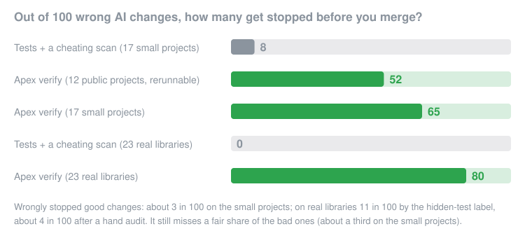

<h1 align="center">Apex verify</h1>
<p align="center"><b>Your AI said it's done. Is it really done?</b></p>
<p align="center">Catch the AI code changes that pass your tests and are still wrong.</p>
<p align="center">
  <a href="https://github.com/apex-engine-dev/apex-verify/actions/workflows/ci.yml"></a>
  <a href="LICENSE"></a>
  <a href="https://github.com/apex-engine-dev/apex-verify/releases/latest"></a>
  
  <a href="https://github.com/apex-engine-dev/apex-verify/stargazers"></a>
</p>

<p align="center"></p>

AI coding agents say "done" when the tests pass. But the tests only check what somebody wrote down. **Apex verify** takes the change an AI made and the task you gave it, has a *different* AI write the missing checks, proves those checks can fail, runs them next to your own tests, and answers `ready`, `not ready` or `unknown`, **with the evidence**. It works on a copy of your code, so your project is never touched.

It checks any change: the working tree an agent just edited, a branch, or a diff from any tool or person. It can also stand in the agent's way (a Claude Code and Gemini CLI hook that blocks "done") and gate pull requests (a GitHub Action).

## Try it in 5 seconds

No key, no project, nothing to install:

```sh
npx --yes https://github.com/apex-engine-dev/apex-verify/releases/latest/download/apex-verify.tgz verify --demo
```

A pretend agent "fixes" a slug function and says done; its project's own tests pass. Apex verify catches what they missed:

```text
apex verify: NOT READY

  - 1 check written from the task fails on the new code
      check: drops punctuation, not just commas
        expected: hello-world
        actual:   hello-world!
      fix: Make the change satisfy the behaviour in the task; the failing check output shows what is expected.

  tests: 2 passed, 0 failed
  checks: 2 passed, 1 failed; written from the task; they fail on the old code
```

## Use it on your own project

You need Node 20+, git, and an API key for the model that writes the checks (use a different, ideally stronger model than your agent's).

```sh
export GEMINI_API_KEY=...        # default checker; see the note on other providers below
cd your-project                  # a git repo where an AI just made a change
npx --yes https://github.com/apex-engine-dev/apex-verify/releases/latest/download/apex-verify.tgz verify "what you asked the AI to do"
```

It downloads a about 60 KB file (about 2 seconds), changes nothing in your project, and prints a verdict. Exit code `0` is ready, `1` not ready, `3` unknown. Other providers: `--provider openai|anthropic|openrouter --model <id>`, or `--base-url` for any OpenAI-compatible endpoint. **Only Gemini has been run live by the maintainer**; if another works or fails for you, please say so in an issue. No key? Add `--no-model`: only your tests and the cheating scan run, and the verdict is at most `unknown`.

## Put it where the change happens

**Claude Code**: block "done" until the change is ready.
```text
/plugin marketplace add apex-engine-dev/apex-verify
/plugin install apex-verify@apex
```
Run in a real Claude Code session: Claude said done on a wrong change, the Stop hook blocked it with the failing checks, and it kept being stopped (at most 3 times, so a wrong check can never trap it).

**GitHub pull requests** (any agent, Copilot, Cursor cloud, or a person): a verdict comment and a required check. Listed on the [GitHub Marketplace](https://github.com/marketplace/actions/apex-verify-ai-change-checker).
```yaml
# .github/workflows/apex-verify.yml
name: Apex verify
on: pull_request
permissions: { contents: read, pull-requests: write }
jobs:
  apex-verify:
    runs-on: ubuntu-latest
    steps:
      - uses: actions/checkout@v4
        with: { fetch-depth: 0 }
      - uses: apex-engine-dev/apex-verify@v1
        with:
          api-key: ${{ secrets.GEMINI_API_KEY }}
```
The task is the pull request's title and description. It posts one comment that it keeps up to date, and fails the job on `not ready` (or when it could not run). Make it a required check to gate merges.

**Gemini CLI**: an `AfterAgent` hook (run in a real session). **Any MCP client**: the `verify_change` tool. **Codex CLI and Cursor**: stop hooks written to their documented formats and tested with synthetic input, **not yet run inside those apps**. Copy-paste configs: [docs/INTEGRATIONS.md](docs/INTEGRATIONS.md). What is and is not tested, per use case: [docs/USE-CASES.md](docs/USE-CASES.md).

## How it decides

1. **Builds the change on a copy** (your working tree, a branch, or a diff file).
2. **Scans for cheating**: tests deleted, skipped, focused with `.only`, a test script that cannot fail, edits to the agent's own configuration. (`--lock-tests` restores the original tests before they run.)
3. **Runs your tests** before and after: a test that passed before and fails now is a regression. A type check counts too if you have one.
4. **A different model writes checks from your task**, never from the agent's own tests. Checks are written for node:test, pytest, Jest, Vitest, Rust (`cargo test`) and Go (`go test`); other stacks still get your tests and the scan.
5. **Proves each check can fail** by running it on the old code first. A check that passes there proves nothing and is thrown away.
6. **Runs the checks on the new code** and answers `ready`, `not ready` (the failing check, expected vs actual, and a hint an agent can act on) or `unknown`. **Never a silent pass.**

Generated checks and your tests run in a sandbox where the platform allows: macOS Seatbelt, Linux bubblewrap, Windows AppContainer (all tested in CI; [limits](docs/SANDBOX.md)). Reports can be signed (`--sign-key`), and `--badge-out` writes a README badge.

## Does it work? The honest numbers

**The short version, on 200 AI-written changes to 23 real open-source libraries:** the projects' own tests already stopped 75 in 100 of the wrong changes. Adding Apex verify's checks raised that to 91 in 100, and of the 27 wrong changes that slipped past the tests it caught 17. The price: it wrongly stopped 23 in 100 good changes (the projects' own tests account for 11 of those, the generated checks for the rest). So it catches more, and it costs you false alarms; `ready` is strong evidence, not a proof.

> **Correction, 2026-11-23:** earlier versions of this page said the projects' tests stopped *none* of the wrong changes on the real libraries. That was wrong: a bug kept Apex verify from running those projects' tests at all, and we had not checked them directly. [What happened and the withdrawn numbers](benchmark/results/real-projects/README.md).

How we know: we collected AI-written changes and knew which were wrong, using hidden tests Apex verify never saw. A "wrong" change looks fine and may pass the visible tests but does not do what the task asked.

<p align="center"></p>

| | Wrong changes stopped | Good changes wrongly stopped |
|---|---|---|
| **17 small projects** (108 changes): tests + cheating scan | about 8 in 100 | not measured separately |
| 17 small projects: **Apex verify** | about 65 in 100 (52 on the 12 public projects you can rerun) | about 3 in 100 |
| **23 real libraries** (200 changes, each task a real historical bug fix): tests + cheating scan | **75 in 100** | 11 in 100 |
| 23 real libraries: **Apex verify** | **91 in 100** | **23 in 100** |

- **Where it helps most is where tests are thin.** On the small projects the visible tests caught almost nothing and the checks did the work. On the real libraries the tests are good, and the checks add a smaller step (75 to 91) at a real cost in false alarms.
- **It still misses things**: about a third of wrong changes on the small projects; on the real libraries 1 wrong change was called `ready` and 9 were left `unknown`.
- **The false alarms are the open problem.** 13 in 100 good changes that pass a real library's tests were stopped by a generated check ([issue #20](https://github.com/apex-engine-dev/apex-verify/issues/20)). Use `APEX_MODE=warn` or `fail-on: never` if that is too many for you.
- **A checker from another company works about as well** (Claude 55 in 100 vs Gemini 63 on the same changes), and **two checkers that must agree did not help** ([experiments, including what failed](docs/EXPERIMENTS.md)).
- Limits: Gemini models wrote every change, one run each, the real-library set is lopsided. Everything is rerunnable: `node benchmark/run-gate.mjs`. **Please try to break it**: a wrong `ready`, or a `not ready` on a good change, is the most useful bug report we can get.

## What it will not do

- **Prove correctness.** It raises the bar; a check can be wrong in both directions.
- **Replace review or CI.** It runs next to them. Run it *in* CI with the Action.
- **Send your code anywhere but the checker you choose**: your task and the relevant source files (about 24 KB at most) go to the model you configure. No telemetry.

## Questions

**Isn't this just CI?** CI runs the tests that exist. The pain is the change nobody wrote a test for, or the test the agent deleted or skipped. Apex verify writes the missing checks, proves they can fail, and flags tampering.

**What does it cost?** One model call per task to write the checks (reused while an agent retries the same task), plus a short second look when a check fails. Seconds and cents. Your tests run locally.

**What if the checker is wrong?** You get `not ready` on a good change or `ready` on a wrong one; the table above shows how often. A suspect check is turned into `unknown` by a second look, the hook never blocks more than 3 times, and `APEX_MODE=warn` never blocks.

**Why a different model?** A model grading its own work shares its blind spots: in our runs a weak model writing checks for its own change blocked over half of the good changes.

## Contribute

If it catches something for you, a ⭐ helps others find it. If it gets something wrong, [open an issue](https://github.com/apex-engine-dev/apex-verify/issues/new/choose): we add your case to the benchmark and credit you.

| You can | Where |
|---|---|
| **Cut the checker's false alarms on real libraries** (13 in 100 good changes) | [issue #20](https://github.com/apex-engine-dev/apex-verify/issues/20) |
| **Run the Codex or Cursor hook** inside the real app and tell us what you saw | a pull request or issue |
| **Add a language or test runner** | issues labelled `good first issue` |
| **Be a second maintainer** | [GOVERNANCE.md](GOVERNANCE.md) |

There is currently **one maintainer**; expect replies in days, not hours.

<details>
<summary><b>What is in this repository</b></summary>

- **[`packages/cli`](packages/cli)**: `apex verify`, the stop hook, the MCP server, the output formats.
- **[`packages/engine`](packages/engine)**: the verification engine (writes and runs the checks, runs your tests, the sandboxes). It contains more than `verify` uses; see [docs/ARCHITECTURE.md](docs/ARCHITECTURE.md).
- **[`benchmark/`](benchmark)**: labelled AI-written changes, the 12 public projects and 23 real-library tasks, results, and the script that re-measures the gate.
- **`action.yml`, [`integrations/`](integrations), [`.claude-plugin/`](.claude-plugin), [`docker/`](docker)**: the GitHub Action, the Claude Code plugin, the container recipe.
- **[`docs/`](docs)**: [integrations](docs/INTEGRATIONS.md), [what works and how we know](docs/USE-CASES.md), [sandbox](docs/SANDBOX.md), [related work](docs/RELATED-WORK.md), [experiments including failures](docs/EXPERIMENTS.md).

[Contributing](CONTRIBUTING.md) · [Roadmap](ROADMAP.md) · [Security](SECURITY.md) · [Status](docs/STATUS.md) · [Changelog](CHANGELOG.md)

</details>

## Licence

**Apache-2.0**: use it, modify it, ship it, at work or in your own products. The Apex verify name and logo are trademarks, not part of that grant ([TRADEMARKS.md](TRADEMARKS.md)): you can fork the code, but not present your fork as Apex verify. Contributions use a DCO sign-off (`git commit -s`) and you keep your copyright.
