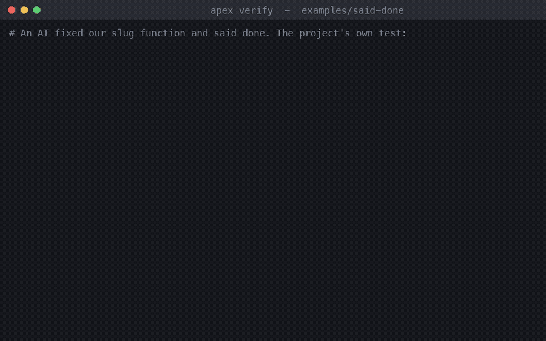

<h1 align="center">ReallyDone</h1>
<p align="center"><b>Your AI said it's done. Is it really done?</b></p>
<p align="center"><sub>ReallyDone, the Apex done-checker</sub></p>
<p align="center">
  <a href="https://github.com/apex-engine-dev/apex-done-checker/actions/workflows/ci.yml"></a>
  <a href="LICENSE"></a>
  
</p>

ReallyDone checks whether an AI agent's code change is **really done**. Give it the change and the task, and it answers `ready`, `not ready` or `unknown`, **with proof**, on a copy of your code, before you merge. Free. Works with Claude Code, Codex, Cursor, Aider, Copilot or a person: nothing to switch.

**Measured:** on AI-written changes judged by hidden tests ReallyDone never saw, an independent checker model blocks **65% of the wrong changes** (28 of 43, across 17 small projects) and wrongly blocks **3% of the right ones**; on the 12 public projects you can rerun yourself it is **52%** (16 of 31) and 2% (1 of 48). Your tests plus a cheating scan alone block 8%. Two independent checkers that must both object keep 60% with only 2% false alarms. ([details and caveats](#how-good-is-it-measured-with-the-caveats))

## See it

<p align="center"></p>

An AI was asked to fix a slug function: *"lowercase letters and digits separated by single dashes"*. It changed the code, the project's own test passes, and it said done. ([the example](examples/said-done); real runs, the exact wording of the checks varies from run to run)

```text
$ reallydone verify "$(cat task.txt)" --diff agent-change.diff
reallydone verify: NOT READY

  - 2 checks written from the task fail on the new code
      check: collapses multiple separators into a single dash
        expected: foo-bar-baz-qux
        actual:   foo-bar---bazqux
      check: trims leading and trailing separators
        expected: hello-world
        actual:   --hello-world
      fix: Make the change satisfy the behaviour in the task; the failing check output shows what is expected.

  tests: 1 passed, 0 failed
  checks: 6 passed, 2 failed; written from the task by gemini-3.1-pro-preview; they fail on the old code
  change: 1 file in the diff
  sandbox: macOS Seatbelt (best effort)
  19.9s, 2 model calls; proof sha256:fd915c61f591...  (--json for the full report)
```

The project's tests were green. A check written from the task by a *different* model, shown to fail on the old code, was not: the change leaves repeated separators as `---` and keeps leading ones.

## Try it in 60 seconds

You need Node 20+, git, and an API key for the model that writes the checks (use a different, ideally stronger model than your agent).

```sh
export GEMINI_API_KEY=...        # or OPENAI_API_KEY with --provider openai --model <id>
cd your-project                  # a git repo where an AI just made a change
npx --yes https://github.com/apex-engine-dev/apex-done-checker/releases/latest/download/reallydone.tgz verify "what you asked the AI to do"
```

The first run downloads a 48 KB file (a couple of seconds). Nothing in your project is changed. Prefer to build it yourself? `git clone https://github.com/apex-engine-dev/apex-done-checker && cd reallydone && npm install` (node dist/reallydone.mjs), or `npx github:apex-engine-dev/apex-done-checker`. You do not need npm to publish or install anything. Exit code `0` ready, `1` not ready, `3` unknown. No key? Add `--no-model`: your tests and a cheating scan still run, and the verdict is at most `unknown`.

## Use it where you work

| You use | Add ReallyDone as | It stops "done"? | Status |
|---|---|---|---|
| **A terminal** | `reallydone verify "<task>"` | You read the verdict | **Tested in CI** |
| **Pull requests (any agent, or people)** | the GitHub Action: `uses: apex-engine-dev/apex-done-checker@v1` | **Yes**, as a required check | **Tested on real PRs**; runs on this repo's own PRs |
| **Claude Code** | `/plugin marketplace add apex-engine-dev/apex-done-checker` then `/plugin install reallydone@reallydone` | **Yes**: the Stop hook hands the failing check back and Claude keeps working | Hook protocol tested in CI, plugin validated; **not yet run in a live session** |
| **Any MCP client** | the `verify_change` tool | The agent asks | Protocol tested in CI; not with a real client |
| **Codex CLI, Gemini CLI, Cursor** | a Stop hook and/or the MCP tool | Yes / partly | **Documented, not tested.** Tell us if it works |

Copy-paste configs: [docs/INTEGRATIONS.md](docs/INTEGRATIONS.md). Exactly what is and is not tested: [docs/USE-CASES.md](docs/USE-CASES.md).

## How it decides

1. **Builds the change on a copy** (from your git working copy, a branch, or a diff file). Your project is never touched.
2. **Scans for cheating**: tests deleted, skipped, focused with `.only`, a test script that cannot fail, edits to the agent's own configuration.
3. **Runs your tests** before and after: a test that passed before and fails now is a regression. If you have a type check (`typecheck` script, or `tsc` with a tsconfig), errors the change introduced count too: a dangling import can leave every test green and still break the build.
4. **An independent model writes checks from your task**, never from the agent's own tests.
5. **Proves the checks can fail**: they run on the old code first. A check that passes on the old code too proves nothing.
6. **Runs them on the new code** and answers: `ready` (checks and tests pass, nothing weakened), `not ready` (a proven problem, with the failing check, expected vs actual, and a fix hint an agent can read), or `unknown` (not enough to say: no checks could be written, the checks cannot tell old from new, or a second look suggests the check itself is wrong). **Never a silent pass.**

## How good is it? Measured, with the caveats

Each change below is an AI-written diff labelled right or wrong by hidden tests that ReallyDone never sees. Everything is rerunnable: `node benchmark/run-gate.mjs` ([benchmark/](benchmark)).

| What judged the change | Wrong changes blocked | Right changes wrongly blocked |
|---|---|---|
| Your tests + the cheating scan only (`--no-model`; 199 changes) | 5 of 65 (**8%**) | 2 of 134 (1%) |
| **+ an independent checker model** (the default; 108 changes, 17 projects) | **28 of 43 (65%**, 95% CI 50-78%) | **2 of 65 (3%**, CI 1-11%) |
| the same, only the 12 public projects (reproducible, 79 changes) | 16 of 31 (52%) | 1 of 48 (2%) |
| Checker from a **different vendor** (Claude vs Gemini, one check set per task, no second look; 191 changes) | Claude 43 of 62 (69%), Gemini 38 of 62 (61%) | Claude 15 of 129 (12%), Gemini 24 of 129 (19%) |
| **Two** independent checkers, block only when both object | 37 of 62 (60%) | **2 of 129 (2%)** |

What this does **not** show: a first measurement on small, mostly single-file projects; the wrong changes come from weaker Gemini models; the default numbers use a Gemini checker (the second-vendor row used Claude as the checker, with different settings, so rows are not strictly comparable); one run per change; the intervals understate the real uncertainty because changes cluster by task. It misses about a third of the wrong changes. Asking the checker for unstated cases (line endings, empty input) gave no gain, so it is off. A weak model writing checks for its *own* change blocked over half of the correct ones (prototype), which is why the checker should be a different model. Method and limits: [benchmark/results](benchmark/results).

Please try to break it: a `ready` that is wrong, or a `not ready` that is right, is the most useful bug report we can get.

## What ReallyDone will not do

- **It is not a proof of correctness.** It raises the bar: checks from an independent model catch a lot that your tests miss, and it says `unknown` when it cannot tell. A check can be wrong in both directions; the numbers above are the honest rates.
- **It does not replace review or CI.** It runs next to them and gives a reviewer (or an agent) a short, evidence-backed verdict.
- **It sends your task and the relevant source files** (a budgeted excerpt, about 24 KB) to the checker model you configure, and nothing else. No telemetry, no other network calls.
- **Generated checks and your tests run on your machine, sandboxed where we can:** macOS Seatbelt (best effort) and Linux bubblewrap (both tested in CI), no network except localhost. **Windows is not supported natively**: use WSL2 or the [container recipe](docs/SANDBOX.md). The sandbox is a safety net, not a security boundary: for code you do not trust, run ReallyDone in CI or a container.
- **Checks are written for node:test and pytest** today. For other stacks ReallyDone still runs your tests (detected, or `--test "<cmd>"`) and the cheating scan, and says `unknown` instead of guessing; Jest/Vitest, Go and Rust are open issues. See [docs/USE-CASES.md](docs/USE-CASES.md).

## Questions you will have

**Isn't this just CI?** CI runs the tests that exist. The pain is the change nobody wrote a test for, or the test the agent deleted or never ran. ReallyDone writes the missing checks from the task, proves they can fail, and flags tampering. It complements CI (run it *in* CI with the Action).

**What does it cost?** One model call per task to write the checks (cached while an agent retries the same task on the same code), plus a short second look when a check fails. Typically seconds and cents. Your tests run locally.

**What if the checker is wrong?** Then you get `not ready` on a correct change (a false alarm) or `ready` on a wrong one (a miss). We measure both and print them above. The second look turns a suspect check into `unknown` instead of a block, the agent hook never blocks more than 3 times, and `REALLYDONE_MODE=warn` never blocks.

**Why a different model?** A model grading its own work shares its blind spots: in our runs a weak model writing checks for its own change blocked over half of the correct changes. Use another model, ideally a stronger one.

## What is in this repository

- **[`packages/cli`](packages/cli)**: `reallydone verify`, the stop hook, the MCP server, the output formats.
- **[`packages/engine`](packages/engine)**: the verification engine it uses (writes and runs the checks, runs your tests, the sandbox). It is shared with a separate commercial product, so it contains more than `verify` uses; see [docs/ARCHITECTURE.md](docs/ARCHITECTURE.md).
- **[`benchmark/`](benchmark)**: labelled AI-written changes, the 12 public projects, results, and the script that re-measures the gate.
- **`action.yml`, [`integrations/`](integrations), [`.claude-plugin/`](.claude-plugin), [`docker/`](docker)**: the GitHub Action, the Claude Code plugin, the container recipe.
- **[`docs/`](docs)**: [integrations](docs/INTEGRATIONS.md), [what works and how we know](docs/USE-CASES.md), [sandbox](docs/SANDBOX.md), [related work](docs/RELATED-WORK.md), [experiments including failures](docs/EXPERIMENTS.md), and an earlier [research track on weaker models](docs/research/WEAK-MODELS.md).

## Join in

| You can | Where |
|---|---|
| Break it: find a wrong change ReallyDone calls `ready`, or a correct one it blocks | [New issue: false ready / false alarm](https://github.com/apex-engine-dev/apex-done-checker/issues/new/choose) |
| Add a language or test runner (Jest/Vitest, Go, Rust, Java, ...) | issues labelled `good first issue` |
| Try it on your real project and tell us if it worked in five minutes | any issue or discussion |
| Be a second maintainer | [GOVERNANCE.md](GOVERNANCE.md) |

[What works](docs/USE-CASES.md) · [Related work](docs/RELATED-WORK.md) · [Contributing](CONTRIBUTING.md) · [Roadmap](ROADMAP.md) · [Security](SECURITY.md) · [Status](docs/STATUS.md) · [Experiments, including failures](docs/EXPERIMENTS.md) · [Changelog](CHANGELOG.md)

There is currently **one maintainer**; expect replies in days, not hours.

## Licence

**Apache-2.0**: use it, modify it, ship it, at work or in your own products. The ReallyDone name and logo are trademarks, not part of that grant ([TRADEMARKS.md](TRADEMARKS.md)): you can fork the code, but not present your fork as ReallyDone. Contributions use a DCO sign-off (`git commit -s`) and you keep your copyright. We plan a paid hosted tier later; this repository (the CLI, the gate, the hooks, the Action) stays open.
